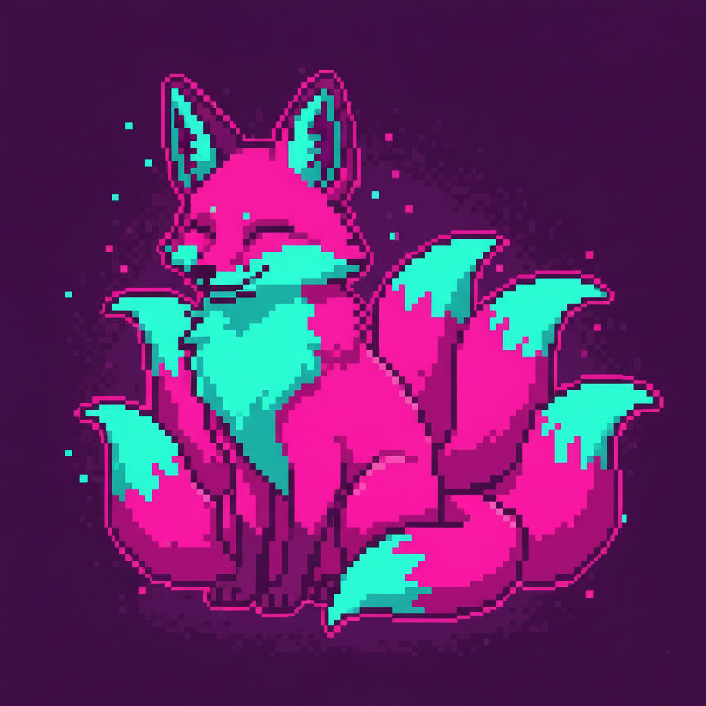

  

### About me

I'm Dyari, a developer from Erbil, Iraq.

I work as a data engineering consultant at Kanidata, building data pipelines and warehouses with Python, SQL, Airflow, Snowflake and dbt.

I also build websites with Next.js and TypeScript and mobile apps with Flutter, from the database to the deploy.

My site: **[dyariali.com](https://dyariali.com)**

 

---

### Contact

---

### Tech stack

**Web** 
      

**Mobile** 
 

**Data** 
   

**Databases** 
     

**Hosting and servers** 
     

**Tools** 
    

**Art and games** 
     

---

<picture>
  <source media="(prefers-color-scheme: dark)" srcset="https://raw.githubusercontent.com/Death-Tail/Death-Tail/output/snake-dark.svg"/>
  <source media="(prefers-color-scheme: light)" srcset="https://raw.githubusercontent.com/Death-Tail/Death-Tail/output/snake.svg"/>
  
</picture>

---

<i>“Every line of code is another tail — all moving toward one purpose.”</i>

